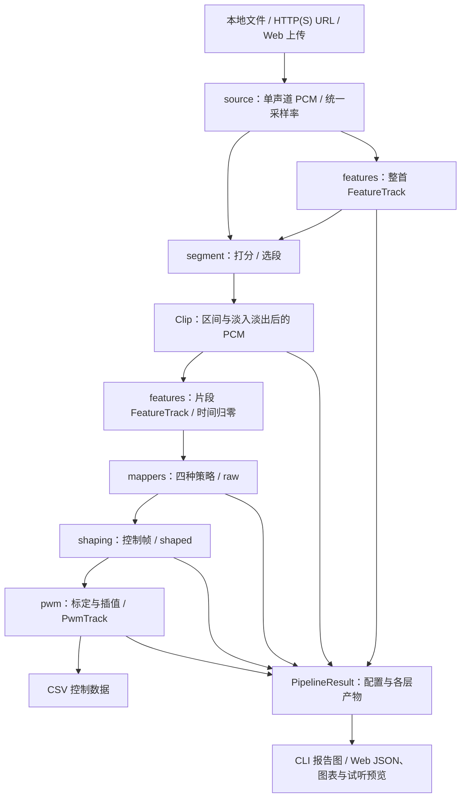

# music2servo 项目设计、需求实现与问题复盘

初审日期：2026-09-29；深入分析补充日期：2026-09-30。审查对象：`music2servo` 目录中的代码、README、三份专题文档及两份验证脚本。本文面向项目汇报、需求对齐、后续开发和维护复盘。

2026-09-29 初审时，目录没有 Git 仓库元数据，无法确认既往修复的提交号、时间或责任人。2026-09-30 核对时，目录已有初始化提交；这仍不能补证初始化之前的修复历史。第 1～7 节保留初审时的记录，第 8 节记录深入分析及补充核对。两次文档工作均未修改算法、接口、测试脚本或运行环境。

直接阅读：[2026-09-30 Web 模拟、节拍识别与舵机运动的深入分析](#web-beat-servo-analysis)。

## 1. 项目概览与完成情况

项目已经形成一条完整的软件处理链：读取音乐，选出片段，提取特征，生成单轴运动目标，施加运动约束，输出按时间排列的 PWM 脉宽数据。CLI 提供 CSV 和调参报告图；本机 Web 界面提供参数编辑、曲线对比、片段试听和尾巴预览。

**现阶段应定位为“已有主体实现的离线算法与调参原型”。** 本次隔离算法检查支持默认参数下的选段、节拍映射和数值约束效果；当前默认 Python 缺少 `soundfile`，常规入口无法完整运行，Web 手动截取还有已确认的序列化冲突。项目尚无真实舵机驱动和实机验收证据。

| 汇报维度 | 当前结论 |
|---|---|
| 已有能力 | 本地文件／URL 读取代码、自动／手动选段、四种映射、成形、PWM 数据导出、CLI、Web 调参和预览。 |
| 本次已验证 | Python／JavaScript 语法；隔离导入后的节拍脚本；合成 PCM 的选段与运动数据；若干边界行为。具体范围见第 5 节。 |
| 当前阻塞 | 缺少 `soundfile`；未提供依赖安装清单；README 所述项目 `.venv` 不存在。 |
| 已知缺口 | Web 手动选段响应、映射参数语义、截取约束和部分文档描述存在问题或差异。 |
| 尚未验收 | 正常入口端到端流程、浏览器完整播放、远程音频、真实歌曲适应性、实际硬件运动。 |

### 1.1 产品边界

- 单舵机、左右一轴，离线处理；当前没有实时音频流、多舵机编排或硬件反馈闭环。
- 输出的是控制数据表，程序没有连接 GPIO、串口或其他硬件控制器，也不直接产生电气 PWM 波形。
- 自动截取默认窗口为 20 秒；窗口可以配置，手动区间可以超过 20 秒。README 的“最长 20s”尚未成为全入口硬约束。
- Web 面向本机单用户，默认监听 `127.0.0.1:8000`。临时分析结果不是持久项目档案。
- 600～2400 微秒、50 Hz、±120°等均为当前默认配置。其中角度用于导出和预览，不能视为已测得的真实舵机行程。

### 1.2 阅读与证据约定

需求表中的“已实现”表示代码路径存在；“局部验证”表示只覆盖指定算法或样本；“待验证”表示没有本次运行证据。三者都不自动等于端到端通过或实机通过。

第 5 节的 `V01～V06` 是本次检查记录，`H01～H02` 是历史文档记录。第 7 节的 `F01～F10` 是后续任务。既有 [架构文档](architecture.md)、[算法文档](algorithms.md)、[调参文档](tuning.md) 保留；与代码有冲突的内容集中列在第 6 节。

## 2. 需求与实现对应表

以下需求从现有 README、专题文档、配置和公开入口整理；项目没有独立、已签署的需求基线，因此不把实现推断当作已确认的产品承诺。

| 需求／目标 | 当前行为 | 状态 | 代码依据 | 验证情况 |
|---|---|---|---|---|
| 读取本地文件或 HTTP(S) 音频 | 后端读取、解码、混为单声道，并重采样；Web 另支持上传音频。 | 已实现，运行受阻 | [source.py](../music2servo/source.py)、[server.py](../web/server.py) | V02：缺解码依赖；本次未验证文件格式或网络下载。 |
| 提取可对齐的音乐特征 | RMS、谱通量、谱质心、高频能量比、YIN 基频共用一个帧栅格。 | 已实现，局部验证 | [features.py](../music2servo/features.py) | V03～V05：合成输入可运行；纯音／噪声检查符合预期。 |
| 自动选出有代表性的片段 | 能量与新颖度加权、平滑、滑窗搜索，再吸附到附近谱通量峰。 | 已实现，局部验证 | [segment.py](../music2servo/segment.py) | V04：80 秒合成音频选中约 29.44～49.44 秒；尚非真实歌曲副歌识别验收。 |
| 手动覆盖区间 | 任一起止参数非空就进入手动分支；得分设为 NaN，区间可超过默认窗口。 | 核心算法已实现；Web 存在缺陷 | [segment.py](../music2servo/segment.py)、[report.py](../web/report.py) | V06：35 秒片段可生成；得分无法按当前 Web 策略序列化。 |
| 切换四种映射 | 支持 envelope、brightness、pitch、beat；允许一次计算多个模式。 | 已实现，语义部分待明确 | [mappers.py](../music2servo/mappers.py)、[pipeline.py](../music2servo/pipeline.py) | V03／V04；pitch 居中和 gain 效果见第 6 节。 |
| 控制运动速度、抖动和首尾过渡 | 低通、控制帧重采样、限速、软死区、首尾回中、最终限速。 | 已实现，默认样本局部验证 | [shaping.py](../music2servo/shaping.py) | V04：四模式最大单步约 0.08；不是任意参数或任意输入的证明。 |
| 导出 PWM 控制数据 | 按中心脉宽分段标定、插值和钳制，CSV 按模式分组输出。 | 已实现，数值生成局部验证 | [pwm.py](../music2servo/pwm.py) | V04：四模式各 995 帧、脉宽在配置范围内；本次未执行 CSV 写盘流程。 |
| 生成调参报告 | 三行 PNG 展示整首与选段、映射与成形、PWM。 | 已实现，本次未验证出图 | [viz.py](../music2servo/viz.py) | H01 为历史记录；本次未检查图片和中文字体。 |
| 提供命令行 | 参数解析、单模式或 all、控制台摘要、PNG 和 CSV 输出。 | 已实现，完整入口未通过 | [__main__.py](../music2servo/__main__.py) | V02 的包导入链被缺失依赖阻塞。 |
| 提供 Web 调参和同步预览 | 六组参数、四张图、音频播放器、尾巴预览与下载链接。 | 已实现，本次未做浏览器验收 | [server.py](../web/server.py)、[app.js](../web/static/app.js) | V01 仅验证脚本语法；V06 发现手动选段响应问题。 |
| 降低重复调参耗时 | 上游配置不变时复用特征，只重跑映射、成形和 PWM。 | 已实现，复用边界待补强 | [server.py](../web/server.py) 的 `_reusable`／`_analyze` | H02 是历史耗时；后端没有独立核验音频身份。 |
| 输入与失败反馈 | 部分解码错误、格式后缀、请求体大小和异常有统一提示。 | 部分实现 | [server.py](../web/server.py)、[config.py](../music2servo/config.py) | 数值范围和跨字段约束缺少统一校验；F02／F03 待处理。 |
| 驱动真实硬件并验证效果 | 当前只有参数、控制帧和屏幕预览。 | 未实现／未验收 | [pwm.py](../music2servo/pwm.py)、[app.js](../web/static/app.js) | 没有实际驱动、负载测试或硬件验收记录。 |

## 3. 架构与接口

### 3.1 数据流与职责



编排由 [pipeline.py](../music2servo/pipeline.py) 负责。整首特征服务全局选段；截取并淡入淡出后的 PCM 再提取一次特征，服务片段映射。当前实现两次都提取五项特征，包括 YIN；双级提取是当前设计选择，不意味着所有特征都被选段算法使用。

映射层输出归一化行程；成形层处理运动约束；PWM 层负责标定、插值和脉宽范围。beat 有明确的跨层约定：映射需要成形配置中的限速值来计算摆幅，并跳过成形的分位拉满。因此不能把各模式的区别概括为“下游行为完全相同”。

Web 主要封装同一套后端算法。前端根据后端返回的时间数组查表，不另算特征、节拍或 PWM。音频下载在后端完成，不依赖浏览器直接跨域取音频；目标站点权限、网络和格式支持仍需另行验证。

### 3.2 六组配置

配置定义见 [config.py](../music2servo/config.py)，由 `PipelineConfig` 组合；参数详表可参照 [tuning.md](tuning.md)，使用时注意第 6 节列出的差异。

| 配置 | 职责 | 当前主要默认值／约定 |
|---|---|---|
| `SourceConfig` | 输入、重采样、调试时长 | `sr=22050`；URL 超时 30 秒；`max_duration_s=None`。时长裁剪发生在完整读取、解码和重采样之后。 |
| `AnalysisConfig` | 频谱与基频分析 | `n_fft=2048`、`hop_length=512`；低频段 30～250 Hz、高频段 2000～8000 Hz；f0 搜索 80～1000 Hz，浊音阈值 0.35。 |
| `SegmentConfig` | 选段与手动覆盖 | 默认窗口 20 秒、平滑 1.5 秒、能量／新颖度权重 0.7／0.3、吸附范围 0.6 秒、淡入淡出 0.3 秒。 |
| `MappingConfig` | 音乐特征到运动目标 | 默认 envelope、gain 1、平滑 0.05 秒；分位 2／98；beat 自动搜索 60～200 BPM，最低响度动态范围 3 dB。 |
| `ShapingConfig` | 运动约束 | 分位 2／98、二阶 4 Hz 低通、25 Hz 控制帧、限速 2/s、软死区 0.02、回中过渡 300 ms。 |
| `ServoConfig` | 输出标定与展示角度 | 50 Hz PWM；最小／中心／最大脉宽 600／1500／2400 微秒；归一化 ±1 对应展示角度 ±120°。 |

这些 dataclass 没有完整的范围和组合校验。默认配置可运行的局部证据，不能推广成任意输入参数都合法；前端数字输入也不能替代后端校验。

### 3.3 时间轴、归一化与物理量

| 层 | 时间约定 | 默认值／注意事项 |
|---|---|---|
| 音频 | 样本时间 `j / sr` | 原始音频和截取音频各有自己的时长。 |
| 分析帧 | 第 i 帧覆盖 `[i*hop, i*hop+n_fft)`，时间标签为帧起点 `i*hop/sr` | 栅格约 43.07 Hz、间隔 23.22 ms；STFT 不补齐尾部。 |
| 节拍事件估计 | onset 帧时间再加 `n_fft/(2*sr)` | 默认补偿约 46.44 ms；这是窗内事件时刻估计，不是逐个鼓点的精确标注。 |
| 控制帧 | 片段相对时间，从 0 开始 | 默认 25 Hz；通过低通后的特征信号插值得到。 |
| PWM 帧 | 片段相对时间，从 0 开始 | 默认 50 Hz；依据 `shaped.duration_s` 生成，后端数组是前端查表依据。 |

RMS 的正确累积和索引为：

```text
S[k] = sum(x[j]^2 for j in [0, k))
start = i * hop
energy[i] = S[start + n_fft] - S[start]
rms[i] = sqrt(max(energy[i], 0) / n_fft)
```

归一化行程的 `-1 / 0 / +1` 分别表示两侧配置边界与中心。单步上限为 `max_rate_per_s / control_hz`，默认 `2/25=0.08`。限速为 2/s 时，中心到一侧距离为 1，至少需要 0.5 秒；从 -1 到 +1 距离为 2，至少需要 1 秒。

降采样前低通是抗混叠措施。截止频率应低于目标控制帧率的一半，也须低于分析采样率的一半，并留过渡带；默认 `4 < 25/2` 满足这一基本关系。当前代码没有对目标控制帧率与截止频率做完整组合校验，短序列等情况下还会跳过滤波，不能据此承诺任意配置都不会混叠。

非空 PWM 的帧数由 `frame_count()` 统一计算：`floor(duration_s * pwm_hz + 1e-6) + 1`，包含起点帧；`render()` 对空控制序列直接返回空结果。完整音频时长、分析时间轴和控制时间轴并不相等。本次 20 秒片段产生 858 个分析帧、995 个 PWM 帧，最后一个 PWM 时间为 19.88 秒。尾巴查表在超出末帧后保持末值，后续硬件播放器的尾部行为尚未定义。

### 3.4 核心对象和调用接口

| 对象／接口 | 含义与调用约定 |
|---|---|
| `PipelineConfig` | 持有 source、analysis、segment、mapping、shaping、servo 六组配置。 |
| `FeatureTrack` | 保存采样率、hop、窗长及五项等长特征；`times_s` 从 0 开始。 |
| `Clip` | 截取 PCM、采样率、原曲起止时间、得分和是否自动；手动模式当前得分为 NaN。 |
| `ShapedTrack` | 控制时间数组和归一化行程；`duration_s` 是最后一个时间点。 |
| `PwmTrack` | 时间、脉宽、展示角度、归一化值和周期微秒数。 |
| `MappingResult` | 一个模式的 `mode / raw / shaped / pwm`，是对比的基本单位。 |
| `PipelineResult` | 来源、配置、整首 PCM／特征／得分、Clip、片段特征及模式结果列表，供后续报告复用。 |
| `run(source_spec, cfg=None, modes=None)` | 完整软件编排；返回 `PipelineResult`。不指定 modes 时使用配置中的单一模式。 |
| `build_mapping(mode, clip_track, cfg)` | 复用片段特征，重跑映射、成形和 PWM；返回 `MappingResult`。 |

CLI 为 `python -m music2servo <输入> [选项]`，默认 envelope，`--mode all` 计算四种模式。Web 默认计算四种模式；部分 beat 参数通过 Python 配置和 Web 提供，没有对应 CLI 开关。

CSV 固定表头为 `mode,frame,time_s,pulse_us,angle_deg,value`。其中 frame 在每个模式内从 0 编号，time_s 相对片段起点，pulse_us 单位为微秒，value 为归一化行程，angle_deg 为 value 乘以配置角度。多模式数据按模式顺序分组写入，不能将所有行直接当作一条单舵机时序，也不能视为多个舵机通道。

### 3.5 Web 接口与结果生命周期

| 方法与路径 | 输入／输出 | 主要行为 |
|---|---|---|
| `GET /api/config` | 返回六组配置的默认值 | 前端使用后端默认值生成参数表单。 |
| `POST /api/analyze` | JSON：`source`，或 `audio_b64 + audio_name`；可带 `config / modes / base_job` | 上传内容优先；完整分析或复用已有片段特征；返回报告数据与下载地址。 |
| `GET /api/clip.wav/{job_id}` | 截取后的 WAV | 已包含淡入淡出；用于片段试听。 |
| `GET /api/frames.csv/{job_id}` | PWM CSV | 返回该 job 的模式结果。 |

分析响应包括 `job_id / source / sr / duration_s / analysis / clip / wave / score / shaping / servo / modes / beat / audio_url / csv_url`。模式数据带各自时间数组；beat 信息包括周期、推算 BPM、相位和极值网格。整首波形最多压为 2400 格、得分曲线最多抽取 3000 点；片段运动数组用于预览查表。

请求体上限为 64 MiB，包含 base64 和 JSON 开销，并非原始音频可上传 64 MiB。服务明确拦截 `.m4a / .m4b / .aac / .mp4` 后缀；本次没有验证其余格式的实际解码能力。

`JobStore` 默认只保留最近 5 个 job，超出时删除旧目录；正常退出时清理临时根目录，旧下载地址会失效。它不提供持久历史、异步任务状态或跨进程恢复。

缓存判定比较 source 配置、analysis 配置和 segment 配置，不比较音频文件内容、路径或 URL。前端在切换上传文件或编辑来源时清空 `base_job`；服务端仍依赖调用方正确使用该字段。已缓存 URL 内容变化、同路径文件替换和直接 API 调用需另行验证。

解码异常按 422、部分参数错误按 400、分析阶段其他异常按 500 返回。JSON 序列化发生在分析异常捕获之外，手动选段的 NaN 可能使请求无法正常返回 JSON；不能把它记为已通过统一错误处理。

## 4. 已处理问题复盘

下表确认的是“当前存在处理机制及其验证范围”。没有修复前版本可供对比时，不推断修复时间、修改次数或改善比例。

| 编号 | 现象 | 原因 | 当前处理 | 验证证据 | 剩余边界 |
|---|---|---|---|---|---|
| D01 | 特征和运动曲线可能错位，难以对比。 | 各特征若采用不同帧定义，时间标签不一致。 | RMS 与 STFT 采用同样的窗起点；片段重新提取特征并归零时间。 | [features.py](../music2servo/features.py)、[pipeline.py](../music2servo/pipeline.py)；V04。 | 对齐栅格不等于每类特征都能精确定位音乐事件；PCM 尾部覆盖见 3.3。 |
| D02 | 噪声也产生“音高”，使 pitch 无意义摆动。 | 只选 YIN 差分最小值会强行给非周期信号分配基频。 | 增加 CMND 浊音阈值，置信不足返回 0；完全无有效基频时 pitch 返回零。 | [features.py](../music2servo/features.py)、[mappers.py](../music2servo/mappers.py)；V05。 | 只验证纯音、白噪和静音等合成信号；复杂和声／人声仍待评估。 |
| D03 | 离群峰值压缩行程，摆动偏向一侧。 | 极值归一化受异常点影响，偏态分布会移动零位。 | 选段与映射使用分位数；envelope、brightness 的基础特征使用中位数双侧归一。 | [mappers.py](../music2servo/mappers.py)；V04，历史描述见 [tuning.md](tuning.md)。 | 属于部分处理：pitch 用配置对数中点；平滑、混合与成形再归一后不保证最终零位和两侧对称。 |
| D04 | 节拍估计出现倍速／半速、量化漂移或固定提前。 | 整数帧周期不够精细，谐波候选有歧义，帧起点不等于事件时刻。 | onset 周期扫描、圆周相位评价、最小二乘精修；事件时间加半窗补偿。 | [mappers.py](../music2servo/mappers.py) 的 `detect_beat_grid`；V03。 | 合成固定 BPM 通过；变速、切分、弱拍和搜索范围边界尚未验收。 |
| D05 | 满幅摆动被限速后，极值迟于拍点。 | 一拍内的目标位移超过限速允许值。 | beat 使用三角波，摆幅取 `min(1, rate*swing/2)`，并跳过成形分位拉满。 | [mappers.py](../music2servo/mappers.py)、[pipeline.py](../music2servo/pipeline.py)；V03。 | 滤波、控制帧采样、首尾过渡仍会带来误差；“每拍一个极值”是目标，不是任意素材的零误差保证。 |
| D06 | 持续音、噪声被误识别为节拍并来回摆动。 | 微小谱通量变化也可能呈准周期。 | 自动 beat 先检查 RMS 的 P95－P5 动态范围，再要求至少 4 个 onset；无法检测则输出零。 | [mappers.py](../music2servo/mappers.py)；V03／V05。 | 手动 `beat_swing_s` 优先于自动门限；关闭门限或输入强压缩音乐的效果另测。 |
| D07 | 高频抖动、重采样混叠，或回中引入额外超速。 | 未滤波降采样会折叠频率；回中斜坡乘原信号可能增大相邻差值。 | 先低通再重采样，限速后软死区和回中，最后再限速；PWM 再钳制。 | [shaping.py](../music2servo/shaping.py)、[pwm.py](../music2servo/pwm.py)；V04。 | 默认样本末端误差不超过一步；并非所有短输入都严格回到零，也没有证明真实机构安全。 |
| D08 | 实现、测试和前端对同一时长算出不同帧数。 | 浮点乘除与取整方式不一致。 | `frame_count()` 集中定义帧数；前端沿用后端时间数组。 | [pwm.py](../music2servo/pwm.py)、[app.js](../web/static/app.js)；V04。 | 当前脚本的帧数断言复用同一函数；后续还需独立覆盖边界与硬件调度语义。 |
| D09 | 改动下游参数仍重复提取特征；切换来源可能保留旧结果。 | 没有区分上游依赖与下游计算，或前端保留旧缓存标识。 | 独立 `build_mapping()`；按三组上游配置复用；输入切换时清理前端缓存标识。 | [server.py](../web/server.py)、[app.js](../web/static/app.js) 源码；H02。 | 本次未测性能或浏览器切换；后端音频身份校验仍缺失。 |
| D10 | 动画若使用独立计时器，可能与音频逐渐偏离。 | 两套时钟的暂停、卡顿和调度状态不同。 | 动画使用 `audio.currentTime` 与 `requestAnimationFrame` 查表。 | [app.js](../web/static/app.js) 的 `tick`；源码确认。 | 尚无播放、拖动、暂停和窗口缩放的浏览器实测，不能宣称端到端声画零延迟。 |

图中文字使用“微秒”避免某些字体缺少 µ 字符，见 [viz.py](../music2servo/viz.py) 和 [README](../README.md)。这是历史环境下的处理；当前字体列表偏向 macOS，不能据此判定 Windows 中文出图已经通过。

## 5. 验证记录

### 5.1 当前环境

| 项目 | 本次核对结果 |
|---|---|
| 工作目录 | `D:\soft\AI\company-project\music2servo` |
| 系统／默认终端 | Windows／PowerShell |
| 默认 Python | `D:\soft\conda\condaSoft\anaconda3\python.exe`，3.13.5 |
| 可用依赖 | numpy 2.1.3、scipy 1.15.3、matplotlib 3.10.0 |
| 缺失依赖 | 默认 Python 无 `soundfile`，导入失败为 `ModuleNotFoundError`。 |
| 项目环境资料 | 当前无 `.venv`，未提供 requirements、pyproject 或 environment 依赖清单。 |
| 版本追溯 | 当前目录无 Git 元数据；本文不绑定提交号。 |

本次没有安装依赖、创建项目虚拟环境或修改系统设置。

### 5.2 本次检查结果

| 编号 | 检查与条件 | 结果 | 证据边界 |
|---|---|---|---|
| V01 | 用 `ast.parse` 解析全部 Python 源码；`node --check web/static/app.js`。 | 16 个 Python 文件与 JavaScript 语法通过。 | 不证明依赖、业务逻辑、浏览器行为或运行入口可用。 |
| V02 | 在项目根目录执行 `python -B tools/verify_beat.py` 和 `python -B tools/verify_segment.py`。 | 两个原生脚本均以非零状态退出，错误为缺少 `soundfile`。 | 完整回归未通过；不是算法断言失败。 |
| V03 | 仅隔离包初始化，加载原算法模块并运行原 `verify_beat.py`；默认参数，20 秒鼓点，起拍 0.37 秒。 | 100／120／140 BPM、手动周期 2 秒及持续音退化检查通过。 | 跳过 `music2servo.__init__`；未覆盖解码、完整 pipeline、CLI、HTTP 和硬件。 |
| V04 | 从原 `verify_segment.py` 读取 `make_song` 函数，生成 80 秒 PCM，直接调用特征、选段、四种映射、成形和 PWM。 | 选段与数值范围符合该样本检查；详细数值见下表。 | 没有执行原脚本 main、文件解码、PNG 或 CSV 写盘，不是原端到端脚本通过。 |
| V05 | 1 秒、22050 Hz，220／660 Hz 正弦、固定随机种子的白噪和全静音。 | 两种正弦各 40/40 帧有效；白噪／静音为 0/40；四种信号自动 beat 均无网格、幅值为 0。 | 只代表这些合成信号。 |
| V06 | 使用 V04 数据检查手动选段、严格 JSON、gain 及 onset 关闭参数。 | 复现第 6 节所列的手动 JSON 冲突、35 秒手动片段、gain 抵消和 0 吸附仍移动。 | JSON 是局部序列化复现，未向 HTTP 服务发起请求；这些结果是缺陷／差异证据，不是修复完成。 |

V03 中的均值是成形后极值到最近真实拍点的平均绝对时间偏差。原脚本还要求最大偏差不超过四分之一拍，不能将下表均值当作最大误差。

| 输入 BPM | 检出相邻极值间隔 | 相位偏差 | 极值平均绝对偏差 | 负／正侧摆幅绝对值 |
|---|---|---|---|---|
| 100 | 约 0.6000 秒 | -9.3 ms | 10.0 ms | 0.5197／0.5197 |
| 120 | 约 0.4999 秒 | -7.9 ms | 10.0 ms | 0.4205／0.4195 |
| 140 | 约 0.4286 秒 | -9.3 ms | 10.2 ms | 0.3492／0.3492 |

V04 采用默认配置。合成高能区为 25～55 秒，检测区间为 29.442902～49.442902 秒，得分约 0.759827。四种模式最大相邻控制位移均约 0.08，PWM 均为 995 帧、末帧时间 19.88 秒。

| 模式 | raw 范围 | shaped 范围 | shaped 末值 | PWM 脉宽范围 |
|---|---|---|---|---|
| envelope | [-1.0000, 0.9918] | [-0.4270, 0.3287] | 0 | 1115.72～1795.85 微秒 |
| brightness | [-0.9948, 0.9781] | [-0.4053, 0.4190] | 0 | 1135.26～1877.08 微秒 |
| pitch | [-0.6755, -0.1965] | [0, 1] | 约 0.00834 | 1500～2400 微秒 |
| beat | [-0.4767, 0.4767] | [-0.4205, 0.4163] | 0 | 1121.53～1874.67 微秒 |

pitch 的 shaped 中位数约 0.96886。这说明当前合成样本仍明显偏向正侧；不能把“归一化已改进”写成“四模式都已保证居中”。这也不足以单独决定产品应采用绝对音高映射还是相对音高映射，需要明确需求。

### 5.3 历史记录与未验证范围

| 编号 | 历史来源 | 原文记录 | 本次处理方式 |
|---|---|---|---|
| H01 | [tuning.md：实测基线与调参发现](tuning.md#实测基线与调参发现)，记录日期 2026-09-27 | 选段约 29.44～49.44 秒、三模式各 995 帧；图片约 402 KB、字体缺字警告为 0。 | 核心数值由本次 PCM 检查部分复核；图片、字体和原生端到端结果没有复核。 |
| H02 | [README：Web 可视化界面](../README.md#web-可视化界面) | 分层缓存实测 496 ms → 40 ms。 | 保留为历史性能记录；没有足够的机器、输入、重复次数信息，本次没有复测。 |

本次未测试音频文件格式矩阵、远程 URL、真实歌曲集合、报告图视觉质量、CSV 文件下载、完整 HTTP 流程、浏览器播放／暂停／拖动／缩放、硬件输出时序和机械效果。已有数值结果不能替代这些验收。

### 5.4 复现隔离算法检查

以下命令在项目根目录的 PowerShell 执行，只使用现有 numpy／scipy 和原源码。它在进程内构造包命名空间以绕过缺失解码依赖的初始化路径，不修改源文件，也不代替正常安装和端到端检查。

```powershell
$env:PYTHONDONTWRITEBYTECODE = '1'
$env:PYTHONIOENCODING = 'utf-8'
@'
import ast
import json
import runpy
import sys
import types
from pathlib import Path

import numpy as np

pkg = types.ModuleType("music2servo")
pkg.__path__ = [str(Path("music2servo").resolve())]
sys.modules["music2servo"] = pkg

# 原节拍脚本的断言；仅跳过包初始化，算法未替换。
beat_check = runpy.run_path("tools/verify_beat.py")
assert beat_check["main"]() == 0

from music2servo import features, mappers, pwm, segment, shaping
from music2servo.config import MappingConfig, SegmentConfig

# 只取原合成函数，避免执行 soundfile 导入与原脚本的文件写入。
tree = ast.parse(Path("tools/verify_segment.py").read_text(encoding="utf-8"))
node = next(n for n in tree.body
            if isinstance(n, ast.FunctionDef) and n.name == "make_song")
fixture = dict(np=np, SR=22050, INTRO_END=25.0, CHORUS_END=55.0, TOTAL=80.0)
exec(compile(ast.Module(body=[node], type_ignores=[]), "<make_song>", "exec"), fixture)
pcm = fixture["make_song"]()
track = features.extract(pcm, 22050)
cfg = SegmentConfig()
score = segment.score_curve(track, cfg)
clip = segment.detect(pcm, 22050, track, score, cfg)
ct = features.extract(clip.pcm, 22050)
assert clip.auto and 23.0 <= clip.start_s <= 37.0
assert abs(clip.duration_s - 20.0) <= 0.05
print("clip", clip.start_s, clip.end_s, clip.score)

for mode in mappers.ORDER:
    raw = mappers.map_track(ct, MappingConfig(mode=mode), 2.0)
    shaped = shaping.shape(raw, ct.hop_s, rescale=mode != "beat")
    frames = pwm.render(shaped)
    assert raw.size == ct.n_frames and np.all(np.isfinite(raw))
    assert np.max(np.abs(raw)) <= 1.0 + 1e-9
    assert np.all(np.isfinite(shaped.values))
    assert np.max(np.abs(shaped.values)) <= 1.0 + 1e-9
    assert abs(shaped.values[0]) <= 1e-9
    assert abs(shaped.values[-1]) <= 0.08 + 1e-9
    assert np.max(np.abs(np.diff(shaped.values))) <= 0.08 + 1e-9
    assert np.all(np.isfinite(frames.pulse_us))
    assert frames.pulse_us.min() >= 600 and frames.pulse_us.max() <= 2400
    assert frames.n_frames == pwm.frame_count(shaped.duration_s, 50.0)
    print(mode, "raw", raw.min(), raw.max(), "shaped",
          shaped.values.min(), shaped.values.max(), "PWM",
          frames.n_frames, frames.duration_s)

# 以下复现的是现状差异，不是期望长期保持的验收行为。
manual = segment.detect(pcm, 22050, track, score,
    SegmentConfig(manual_start_s=5.0, manual_end_s=40.0))
print("manual_duration", manual.duration_s)
try:
    json.dumps({"clip": {"score": float(manual.score)}}, allow_nan=False)
except ValueError as exc:
    print("manual_json_error", exc)

outputs = []
for gain in (1.0, 0.5):
    raw = mappers.map_track(ct, MappingConfig(mode="envelope", gain=gain))
    outputs.append(shaping.shape(raw, ct.hop_s).values)
print("gain_output_max_diff", np.max(np.abs(outputs[0] - outputs[1])))

start, _ = segment._best_window(score, track.hop_s, 20.0, len(pcm) / 22050)
aligned = segment._align_to_onset(track, start, 0.0, 20.0, len(pcm) / 22050)
print("onset_zero_before_after", start, aligned)
'@ | python -B -
```

该复现段调用了两个内部选段函数以定位问题，它们不是新增公共 API；后续内部重构时应同步调整此诊断示例。V05 的纯音／噪声检查是另一次局部检查，不包含在上述命令中。

## 6. 现有文档与实现的差异

本节集中说明冲突，避免汇报沿用过度承诺。既有专题文档本次不改写；其中的历史经验仍可参考，但下列内容应以代码和本次证据为准。

| 差异 | 代码／本次证据 | 当前应采用的描述 | 后续任务 |
|---|---|---|---|
| README 说已有项目虚拟环境和 soundfile。 | V02；本机核对见 5.1。 | 这是历史环境说明，当前环境未就绪。 | F01 |
| README 说片段“最长 20s”。 | 手动 5～40 秒得到 35 秒；自动窗口也可配置。 | 20 秒是默认值；是否硬上限仍待需求确认。 | F06 |
| 三个连续模式“都走中位数归一”。 | `_map_pitch` 使用配置 floor／ceil 的对数中点；本次 pitch 输出仍偏单侧。 | envelope／brightness 基础特征采用样本中位数；pitch 当前是配置音高参考。 | F05／F08 |
| gain 可以直接用于压缩最终行程。 | V06：envelope 的 gain 1.0／0.5 最终 shaped 最大差为 0。 | 连续模式的二次分位拉满可抵消未裁剪的正增益缩放；不能承诺 gain 就是最终幅度旋钮。 | F05 |
| onset 吸附“只向前”，设 0 可以关闭。 | 搜索实际为前后范围；reach 至少为 1；V06 起点从 29.675102 移到 29.698322 秒。 | 当前双向搜索，0 不会真正禁用；beat 的半窗补偿也未用于此选段吸附函数。 | F06／F08 |
| RMS 累积和终点写成 `(i+1)*hop+n_fft`。 | [features.py](../music2servo/features.py) 使用 `i*hop+n_fft`。 | 使用 3.3 的正确公式，窗口长度是 n_fft。 | F08 |
| 控制帧率“必须低于低通截止的奈奎斯特”。 | 默认控制帧率 25 Hz、截止 4 Hz。 | 低通截止应低于目标控制帧率的一半，并考虑过渡带；需增加组合校验。 | F03／F08 |
| 2/s 可在 0.5 秒走完 -1～+1 全程。 | 全程距离为 2，时间下限是距离除以速度。 | 0.5 秒是中心到一侧；两侧之间至少 1 秒。 | F08 |
| 多模式差异“100% 只来自映射”。 | `build_mapping` 对 beat 设置 `rescale=False`，并将限速传入映射。 | 配置共享，但 beat 存在明确的成形例外。 | F08 |
| Web 手动选段可正常作为兜底。 | `segment.detect` 产生 NaN；`build_payload` 保留它；`_send_json` 禁止 NaN。 | 核心选段可运行，Web 响应路径存在局部确认的序列化缺陷。 | F02 |
| 声画“严格对齐”、字体警告已经解决。 | 只有共享音频时钟的代码依据和历史字体记录。 | 具备同步机制；本机浏览器体验与字体仍待验证。 | F07／F09 |

## 7. 后续开发顺序与完成判据

优先级含义：P1 为恢复可复现运行、打通已公开功能；P2 为明确语义、修补边界并补齐验收；P3 为维护性改进。下表是后续任务登记，本次没有实施这些修复，也没有代替产品或硬件负责人作尚未确定的选择。

| 编号／优先级 | 类型与任务 | 完成判据 |
|---|---|---|
| F01／P1 | 运行阻塞：补齐依赖安装说明与可复现环境，处理验证脚本的 `/tmp` 固定路径。 | 在干净 Windows 环境按文档安装；包、CLI、Web 可正常导入；临时目录不依赖预建固定路径；两个原生验证脚本完成运行，记录退出码及报告产物。 |
| F02／P1 | 功能缺陷：修复手动片段得分的 JSON 表达和前端无得分展示。 | 明确“无自动得分”的接口表示，统一前后端；手动起点、终点、双端三种请求均返回合法 JSON；界面不对空得分调用数值格式化，图表、音频和 CSV 可用。 |
| F03／P2 | 参数边界：建立六组配置的范围、类型和组合校验。 | 覆盖非有限数、非正采样率／帧率、非法窗长／hop、分位顺序、低通与目标帧率关系、脉宽 min／center／max 顺序；错误在计算前以可读方式返回；有效默认输出不变。 |
| F04／P2 | 缓存一致性：明确来源身份、失效和 job 生命周期。 | 明确同路径文件替换与 URL 内容变化的复用政策；切换 A／B 音频、错误 base_job、旧 job 被淘汰时不混用音频和运动；上游变化重算，下游变化确实复用。 |
| F05／P2 | 映射需求：确认 pitch 的绝对／相对音高语义，以及 gain 是否控制最终行程。 | 先记录产品预期，再制定偏态音高、无基频、不同 gain、不同模式的验收；如选择改变算法，保留前后曲线与数值对比，明确节拍幅度约束。 |
| F06／P2 | 截取需求：确认 20 秒是否硬上限，修复 onset 关闭语义并明确吸附方向。 | Python／CLI／Web 的自动、手动行为一致且有说明；0 真正不移动起点；覆盖仅起点、仅终点、越界、反向、短片段和尾部；决定吸附后得分是否重算。 |
| F07／P2 | 浏览器行为：检查窗口重绘、来源切换和播放状态。 | 播放中缩放窗口、暂停、拖动进度、重算和换源符合预期；确认 resize 调用 `drawAll()` 时重新设置 `audio.src` 是否重置播放，并完成必要修复。 |
| F08／P2 | 文档一致性：同步既有专题文档、注释和参数帮助。 | 第 6 节冲突逐项消除；公式、默认值、接口名和模式例外与代码一致；历史基线保留日期与范围；不把本文登记的问题写成已经修复。 |
| F09／P2 | 验收缺口：补真实歌曲、文件格式、端到端界面及硬件测试。 | 建立有样本和判据的音乐集合；完成 CLI 报告、CSV、HTTP 与浏览器操作验证。硬件选型和播放器调度方案确定后，另测脉宽／角度标定、时间同步、尾部回中和负载效果。 |
| F10／P3 | 维护性：控制前端职责集中带来的修改成本。 | 当前 `app.js` 约 936 行；以后涉及明显扩展时，按表单、图表、播放或请求状态等真实职责评估拆分。拆分须有行为验证，不创建仅转发调用的包装模块。 |

F05、F06 的产品语义和 F09 的硬件参数在初审时仍属待确认需求。默认值可以用于软件实验，不能直接成为硬件能力承诺。以上是 2026-09-29 文档工作的完成边界，后续深入分析见第 8 节。

<a id="web-beat-servo-analysis"></a>

## 8. 2026-09-30 Web 模拟、节拍识别与舵机运动的深入分析

### 8.1 结论、已确认目标与本次交付

**需要进一步优化。** 已定位的问题涉及参数单位、归一化零位、节拍跟踪、可达运动轨迹及网页播放状态。提高帧率或单独增加平滑不能同时解决这些问题。

原会话已经确认的动作目标为：**每拍交替到达左右端点并换向；踩点和平滑优先，速度不足时自动缩小摆幅。** 用户当时尚未确定舵机与机构，也没有指定发生卡顿的模式或提供真实音频样本。三种连续特征映射保留为对比能力，以 beat 模式承担每拍换边的目标。

本次按原方案完成文档交付：增补分析、保存诊断证据、登记优化顺序和验收判据。第 8.7 节的软件改动仍是后续任务，当前没有实施修复，也没有完成实机验收。

证据来源分为两类：

- **本轮复测**：读取原会话的诊断代码，对当前源码重新运行隔离算法检查；未安装依赖，未替换算法。结果、复现代码、环境和源码 SHA-256 保存于 [诊断证据 JSON](analysis-2026-09-30-evidence.json)。
- **原会话浏览器记录**：session `01a0eca1-e787-7390-9459-289960f46874`，2026-09-30 的模拟报告和浏览器静音音频检查。该结果没有经过真实后端分析接口，本轮只提取并核对记录，未再次运行浏览器测试。

本轮检查前 Git HEAD 为 `3a02a26779104945ea12b187291d383d273db7d7`，2026-09-30 初始化提交。记录这个提交仅用于关联当前快照，不推断旧问题的修复提交或负责人。默认 Python 为 3.13.5，numpy、scipy 可导入，`soundfile` 仍缺失。

### 8.2 数值单位、角度与控制指令

| 数值 | 单位与当前含义 | 使用边界 |
|---|---|---|
| `value` | 无量纲，范围 `[-1,1]`；0 为中位，正负代表左右目标位置 | 不是角速度、加速度或力矩；零位是否保留取决于后续处理 |
| `angle_deg` | 度；当前等于 `value × angle_max_deg` | 是标称展示角度，尚无实测机械标定依据 |
| `pulse_us` | 微秒；按 `pulse_min_us / pulse_center_us / pulse_max_us` 分段标定 | 是待发送的舵机控制脉宽；CSV 本身不产生电气波形 |
| `max_rate_per_s` | 归一化行程/秒；默认 2/s | 从 −1 到 +1 的距离为 2，因此至少需要 1 秒 |
| `beat_swing_s` | 秒；相邻左右极值的间隔 | 表示一次换边时间；完整左右往返需要两倍时间 |
| `control_hz` | Hz；默认 25 | 目标轨迹采样率，默认每 40 ms 一个位置 |
| `pwm_hz` | Hz；默认 50 | 控制指令的时间栅格，默认每 20 ms 一帧 |

依据：[配置](../music2servo/config.py)、[PWM 标定和插值](../music2servo/pwm.py)。当前正侧脉宽为 `center + value × (max − center)`，负侧为 `center + value × (center − min)`。

本轮使用相同的五个控制点 `[-1,-0.5,0,0.5,1]`，只把 `angle_max_deg` 从 120 改为 60：两次生成的脉宽数组完全相同，标称角度峰值从 120° 变成 60°。因此这个参数目前只能改变展示角度，不能用作真实运动的缩幅旋钮。

默认标称范围是 −120°～+120°，总行程 240°；这不是未选型舵机的能力证明。按当前默认标定，2/s 对应标称目标角速度上限 240°/s，两侧脉宽变化率均为 1800 µs/s；这些换算只是软件目标值，不是实测速度。

后续应区分三种参数：机械中位/左右脉宽标定、实际运动幅度、标称角度展示。幅度控制应改变用于导出的 `value` 和脉宽，再由同一数据驱动预览；不能只缩小网页角度。舵机中心、脉宽与角度对应关系及转向均需要按具体硬件标定，参见 [Pololu 舵机控制接口说明](https://www.pololu.com/blog/17/servo-control-interface-in-detail)。

### 8.3 左右偏移、归一化与 gain

当前责任分散在两层：[映射层](../music2servo/mappers.py)先建立特征到 `[-1,1]` 的关系，[成形层](../music2servo/shaping.py)再将 P2～P98 线性拉满。这会改变原来的零位，并抵消未饱和的正增益缩放。

`pitch` 使用配置音高上下限的对数中点，不是片段音高中位数。按默认 80～1000 Hz，参考中点约为 282.84 Hz；片段的主要音高不在这里时，输出可能偏向一侧。`invert` 只会交换方向，不能解决偏侧。

本轮六秒样本 A 为 220 Hz、幅度 0.08 的持续音，加 120 BPM、50 ms 的衰减脉冲，不加片段淡入淡出。默认参数下的阶段结果如下：

| 模式 | 映射后中位数 | 成形首步再归一后的中位数 | 最终控制范围 | gain 1 与 0.5 的最终最大差 |
|---|---:|---:|---|---:|
| envelope | −0.179004 | −0.267840 | `[−0.555328,0]` | 0 |
| brightness | −0.098257 | −0.501473 | `[−0.699584,0]` | 0 |
| pitch | −0.198932 | +0.982827 | `[0,1]` | 0 |

映射后的中位数已包含该层的平滑；中位数居中不意味着平滑、混合和后续成形后的中位数仍严格为零。表中的最终范围属于这个样本，不是所有歌曲都会产生相同偏移。

另一个带默认淡入淡出的六秒样本 B 也得到 pitch 的最终范围 `[0,1]`，详见 8.6。原方案曾报告另一组阶段检查的再归一中位数约 +0.989；本轮样本 A 的复测为 +0.982827，保留各自条件，不将两次数字当成同一个测量。

后续应让特征归一化在映射层拥有明确的零位，再应用幅度控制；成形层只处理运动约束，不无条件重新拉满。pitch 的绝对音高/相对片段音高语义仍需产品确认，F05 的这个缺口没有被本次诊断替代。改变默认语义时，应记录兼容影响及前后曲线。

### 8.4 节拍识别与独立误差指标

当前 `detect_beat_grid()` 只返回一个周期和相位：响度动态门限 → onset 提取 → 周期扫描 → 最小二乘拟合。动作和 Web 拍点都基于这个全片网格；Web 的 [报告生成](../web/report.py)会另外调用一次检测。这能保证同一算法下的显示逻辑，但没有局部速度、活动区间或足够的可信度拒绝机制。

**图上拍线与动作重合只证明内部一致。** 独立评价必须使用合成音频生成时给定的拍点，或真实歌曲的人工标注；不能把算法自己的拍点当作真值。

本轮使用原会话的 20 秒合成 PCM 诊断代码：22050 Hz，首拍 0.37 秒，50 ms 衰减的 150/900 Hz 脉冲，固定种子 0 的微弱噪声，其他配置默认。误差只统计 1～19 秒以避开首尾过渡；检测点和成形后正负极值分别匹配最近真实拍点。

| 场景 | 检测拍点 MAE / P95 | 成形后换向 MAE | 其他结果 |
|---|---|---|---|
| 固定 60/80/100/120/140/160/180/200 BPM | MAE 7.32～9.09 ms，P95 9.10～10.13 ms | 各 10.00 ms | 每档 40 ms 匹配窗口内的 precision/recall 均为 1 |
| 120 BPM，强弱拍幅度 1/0.15 交替 | 8.29 / 9.56 ms | 10.00 ms | 此样本的 precision/recall 均为 1 |
| 强持续音叠加弱拍 | 未检出 | 不适用 | 背景幅度 0.5、脉冲幅度 0.08，响度动态仅 0.034 dB，被 3 dB 门限拒绝 |
| 10～14 秒停鼓 | 284.32 / 1629.34 ms | 285.56 ms | 网格仍延伸；10.5～13.5 秒动作峰值 0.4193；precision 0.778、recall 1 |
| 不规则敲击 | 111.69 / 251.32 ms | 104.95 ms | 种子 7、间隔 0.32～0.82 秒，仍拟合为 96.664 BPM；precision 0.241、recall 0.219 |
| 100→140 BPM 渐变 | 124.06 / 241.55 ms | 127.67 ms | 事件迭代间隔为 `60/(100+40*t/20)`；检测仍折算为 99.857 BPM |
| 100→140 BPM 突变 | 122.60 / 262.84 ms | 122.01 ms | 10 秒前后切速，被折中成 130.736 BPM |

MAE 是平均绝对误差，P95 是绝对误差的 95 分位。上述 precision 是预测拍点中距离真值不超过 40 ms 的比例，recall 是真值中距离预测不超过 40 ms 的比例；诊断采用最近点匹配，没有强制一对一。单独报告到最近拍点的误差可能掩盖漏拍和重复拍，正式验收还需一对一匹配、拍数及左右交替检查。

停鼓指标以“实际未生成脉冲的区间”为真值，仅证明这个明确停拍样本仍有持续摆动。真实歌曲是否保留节拍感、何时衰减动作，仍要按音乐标注和已确认动作目标验收。

后续检测产物应包含拍点序列、局部速度、可信度和活动区间，并由轨迹、图表和报告共同使用一次检测的结果。低可信度应有可见的拒绝/退化状态；局部停拍应按受限轨迹回中。手动 `beat_swing_s` 是用户显式指定的周期，应保留它优先于自动识别的语义。

### 8.5 可达摆幅、换向和时间栅格

设单侧摆幅为 A、相邻左右极值间隔为 T、速度上限为 r。三角轨迹跨越的距离是 2A，必要条件为：

```text
2A / T ≤ r
A ≤ min(1, r × T / 2)
```

120 BPM 时 T=0.5 秒、r=2/s，因此单侧摆幅最多 0.5。当前 beat 映射先按这个上限缩幅，却在公共 `map_track()` 收尾时再乘 gain，增益可能再次提出不可达的目标，限速器于是削减并推迟极值。

| beat gain | 最终负侧 / 正侧极值 | 换向 MAE / 最大误差 | 标称目标二阶差分峰值 |
|---:|---|---|---:|
| 0.5 | −0.2003 / +0.1998 | 10.00 / 10.00 ms | 2908.37 °/s² |
| 1.0 | −0.4205 / +0.4195 | 10.00 / 10.00 ms | 5041.72 °/s² |
| 1.5 | −0.4872 / +0.5058 | 80.00 / 90.00 ms | 11518.09 °/s² |
| 2.0 | −0.4911 / +0.4897 | 119.71 / 130.00 ms | 10682.05 °/s² |

本表使用相同的 120 BPM 合成音频。最后一列由 25 Hz 控制点、默认标称 ±120°的角度二阶差分计算，只统计 1～19 秒；它是离散目标诊断值，不是实际机械加速度。目前只有速度限制，没有明确的加速度约束。

三角波在端点瞬间换向；低通虽然会磨圆拐角，不能替代同时满足踩点、速度和柔和换向的轨迹规划。后续应把 gain、端点停速、首尾回中纳入同一次可达性计算，在保持每拍交替的前提下继续缩幅。

默认时间轴需分别理解：分析 hop 约 23.22 ms，窗长约 92.88 ms；控制轨迹每 40 ms 一点；PWM 数据每 20 ms 一点；网页通过 `requestAnimationFrame` 按音频 `currentTime` 查表插值。25 Hz 控制轨迹不等于网页只能显示 25 帧，提高绘制频率不会修正错拍或不可达位移。

共享音频时钟有助于避免累计漂移，但不证明设备输出延迟为零，也不能保证后台标签页按固定频率绘制。浏览器帧调度边界参见 [MDN requestAnimationFrame](https://developer.mozilla.org/en-US/docs/Web/API/Window/requestAnimationFrame)。

### 8.6 Web 播放、模式切换与末尾回中

原会话浏览器检查使用原前端、六秒合成报告和浏览器静音音频，在 `http://music2servo.test/` 拦截请求提供 fixture；没有调用真实 `/api/analyze`。因此它定位的是前端交互问题，不是完整音频处理或真实歌曲试听验收。

| 问题 | 条件与结果 | 原因与后续处理 |
|---|---|---|
| 窗口缩放打断播放 | 原会话播放至 2.455125 秒，窗口宽度增加 80 px 后等待 500 ms；音频回到 0 秒并暂停，收到 emptied/loadstart 事件 | resize 触发 `drawAll()`，其中重新设置 `els.clip.src`；分离布局重绘与音频资源加载 |
| 切模式瞬间跳角度 | 同一 2.4 秒位置由 envelope 切 pitch：约 −13.4° → +67.6°，跳变约 81° | `tick()` 直接查新模式的目标，没有运动过渡；按原方案采用暂停、受限回中、新模式从头重播 |
| 限速后未严格回中 | 本轮常量 +1、150 点、40 ms hop、`rescale=False`：起点 0，终点约 0.02，最大单步 0.08 | 回中后再次前向限速可能留下末端残差；需要提前规划首尾边界 |

前端依据：[drawAll、tick 和事件绑定](../web/static/app.js)。原会话两项浏览器结果及时间戳已存入证据 JSON 的 `historical_browser_probes`。加载操作会重置媒体状态的语义参见 [MDN HTMLMediaElement.load](https://developer.mozilla.org/en-US/docs/Web/API/HTMLMediaElement/load)；具体 resize 结论以这次局部浏览器记录为依据。

本轮样本 B 为六秒 220 Hz、幅度 0.12 的持续音，加幅度 0.65、80 ms 的 120 BPM 脉冲和种子 0 的微弱噪声，再使用原 `segment._apply_fade()` 施加默认淡入淡出。四种模式结果如下：

| 模式 | 最终控制范围 | 最后值 | 最大单步 |
|---|---|---:|---:|
| envelope | `[−0.330740,+0.331626]` | 0 | 0.08 |
| brightness | `[−0.097887,+0.599861]` | 0 | 0.08 |
| pitch | `[0,+1]` | 0.006369 | 0.08 |
| beat | `[−0.419495,+0.417634]` | 0 | 0.08 |

四模式控制轨迹的末时刻均为 5.88 秒。这个样本再次说明“速度未超限”与“最后值严格为零”是两个独立判据；不能直接将末点强行改零而忽略最后一步的速度。软件目标轨迹还需独立核查加速度与 PWM 插值后的约束。

### 8.7 优化顺序、依赖与完成判据

以下任务尚未实施。编号 `W01～W06` 表示本轮深化的后续工作，不替换初审 `F01～F10` 的状态。

| 顺序 / 编号 | 工作与责任边界 | 完成判据 | 与初审任务关系 |
|---|---|---|---|
| P0 / W01 | 前端分离资源加载和布局重绘；明确重新分析/换源才更换音频 | 播放中缩放不暂停、不跳进度；暂停与拖动保持状态；确需换源时按明确规则重置 | 深化 F07 |
| P0 / W02 | 映射层统一归一化零位；幅度控制与脉宽标定分开；成形不无条件拉满 | 无饱和样本中 gain 缩幅确实改变导出行程和脉宽；覆盖偏态特征、无基频和四种模式；预览与导出一致；记录 pitch 语义选择及兼容变化 | 深化 F05/F08 |
| P1 / W03 | 检测输出升级为局部拍点、速度、可信度和活动区间；报告/轨迹共用同一产物 | 固定、渐变、突变、停鼓、弱拍、随机敲击分别验收；能拒绝不可靠样本；人工标注作为真实音乐参照；显式手动周期优先 | 深化 F09，关联 D04/D06 |
| P1 / W04 | 从拍点规划可达轨迹，将 gain、柔和换向、首尾回中和速度约束统一处理 | 每拍交替换向；增大 gain 不引入系统性滞后；端点速度连续；首末回中且全过程不超限；报告实际缩幅和限制状态 | 深化 F05/F09，关联 D05/D07 |
| P1 / W05 | 模式切换采用暂停、受限回中、新模式重播；展示目标角度、脉宽和约束状态 | 播放/暂停/拖动/切模式/重新分析行为一致；切换不直接瞬移；展示与 CSV 使用同一输出数据 | 深化 F07/F09 |
| P2 / W06 | 使用真实音乐补端到端验收；选型后标定机械中位、左右范围、方向、速度和到位延迟 | 完整试听和运动复核通过；实际负载下测量到位误差与换向；实测机械角度对应指令；记录供电和机构条件 | 深化 F09 |

软件修改前还需完成 F01 的可复现环境；手动截取的严格 JSON 冲突由 F02 处理；参数范围与组合校验沿用 F03；输入身份和缓存生命周期沿用 F04。这些缺口不因本次加入诊断记录而自动关闭。

W02 应先稳定幅度与零位语义；W03 产出的局部拍点再提供给 W04；W05 使用 W04 的约束数据管理过渡；最后由 W06 验证真实系统。可以先处理独立的 W01，但不能用前端显示修复代替算法和机械验收。

首轮节拍改进目标保留原方案约定：固定合成节拍保持当前约 10 ms 的平均换向表现；渐变/突变样本的换向 MAE ≤40 ms、P95 ≤80 ms。拍点识别误差与轨迹到达误差分开报告，同时统计一对一匹配的 precision/recall、漏拍和重复拍。上述阈值是待验证的开发目标，不是当前通过结果；真实歌曲另行制定标注和试听判据。

运动验收需同时检查有限值、归一化范围、脉宽范围、左右交替、速度、首尾值、端点速度连续性及加速度。加速度阈值要按后续软件配置和硬件条件明确，不凭现有二阶差分数字推断舵机能力。

### 8.8 验证记录、复现方式与交付边界

| 编号 | 证据类型与检查 | 本轮结果 | 验证边界 |
|---|---|---|---|
| I01 | 本轮重跑原会话的节拍、gain 和角度诊断 | 19 条结果；复现 8.2、8.4、8.5 的数值问题 | 隔离原模块，跳过包初始化；没有解码、正常 pipeline 入口、CLI 或 HTTP |
| I02 | 本轮重跑常量回中和带淡入淡出的四模式诊断 | 2 条汇总记录；复现末端残差、单侧输出及单步上限 | 常量输入是边界探针，合成 PCM 是局部算法路径 |
| I03 | 本轮用六秒样本 A 检查归一化阶段与 gain | 3 条结果；三种连续模式的 gain 输出最大差均为 0 | 与样本 B 的背景、脉冲和淡入淡出条件不同，不混用阶段数字 |
| I04 | 提取原会话 resize 与切模式结果，重新核对前端源码 | 2 条浏览器记录及对应原因已整理 | 历史模拟报告；本轮没有重跑浏览器，不是后端端到端通过 |

证据 JSON 保存了三个隔离诊断的完整 Python 源码、24 条本轮算法结果、两条原会话浏览器结果、源码 SHA-256、检查前 HEAD 和环境信息。可在 PowerShell 复跑其中一个探针，不需要恢复原 session：

```powershell
@'
import json, os, subprocess, sys
from pathlib import Path
evidence = json.loads(Path("docs/analysis-2026-09-30-evidence.json").read_text(encoding="utf-8"))
probe = next(p for p in evidence["algorithm_reruns"] if p["name"] == "beat_and_units")
env = dict(os.environ, PYTHONDONTWRITEBYTECODE="1", PYTHONIOENCODING="utf-8")
result = subprocess.run([sys.executable, "-B", "-"], input=probe["python_source"],
    text=True, encoding="utf-8", env=env)
raise SystemExit(result.returncode)
'@ | python -B -
```

这些代码使用少量内部函数定位问题，不构成新增公共 API；源码变化后，应先核对证据中的哈希，再更新诊断和解释。本轮复测的进程退出码为 0 表示探针成功运行并产出数据，不表示缺陷已修复。

本次没有修改生产源码、验证脚本或依赖环境。没有真实歌曲、常规入口完整运行、真实 `/api/analyze` 流程、真实后端下的完整浏览器播放或硬件验收；本节的结果支持问题定位和后续开发，不代表完整系统已通过。
